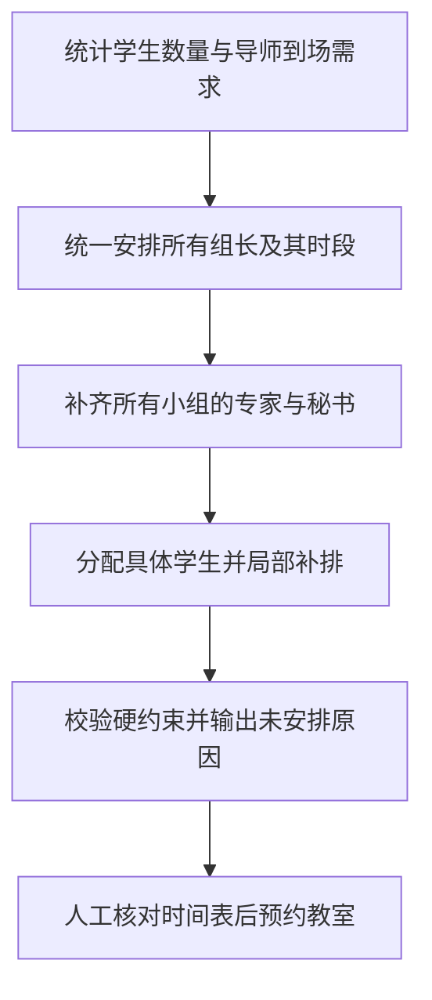

# 三阶段排期算法与优化

更新日期：2026-10-29。适用范围：当前源码中新生成的预答辩、正式答辩（`policy_version: 3`）。需求依据为[问题清单](../答辩系统问题清单%20%282%29.md)，并补充用户确认的全局顺序：**先排完组长，再补齐教师，最后分配学生**。

中期答辩仍使用 policy 2；旧 policy 1/2 版本按原规则解释，不将新人数规则追溯套用到历史结果。2026-10-23 的 301 人结果属于旧规则验证，不能直接作为本次新版验收证据。

## 最新人数优先规则（2026-10-30）

组号与顺序补充：预答辩排组长阶段使用的编号是内部临时号，完成集中到场及跨组优化后，按最终日期、上午／下午确定 G001、G002……正式组号；首次保存后固定，不在手调时自动改号。正式答辩沿用该学生组、组号和秘书，并按同一组号顺序安排本阶段日期。两阶段的日期各不相同，但组序相同。缓存复用仅在生成新预答辩草稿时重新确定初始编号，不修改历史版本。

当前新排期每组硬下限为 5、上限 7，以 6 人为目标。API、配置保存、前端编辑和排期生成统一该范围；历史快照继续按各自规则解释，不追溯修改已有分组。预答辩先尝试一位外院专家；人数下界不足或严格编排留有未安排学生时，再允许必要小组有两位外院导师。导师评审、角色资格及时间互斥不变。

后续明确：组内各评审教师所带学生数基本平均、教师实际参加次数接近，与组人数目标同为主要质量目标；不能把公平性降为六人组比例之后的微小决胜项。5～7 人及人员资格、时间互斥仍是硬约束。

`scheduling/balanced_counts.py` 按导师计数生成有限可行组合。质量成本由偏离目标人数的平方、组内学生集中度和导师参加次数平方之和共同组成，各项采用同量级单位成本。组内集中度为实际各导师人数平方和与最均衡整数分配的平方和之差的一半，含没有学生的补充评审的零名额，不含秘书。覆盖搜索后约束未覆盖人数不得增加，再改进联合质量目标。五专家模式新增四、五导师候选，使用有限采样及组内均衡排序保留候选，避免只考虑最多三导师的结构性偏差。

需求阶段的参加次数是导师任务估计；组长和教师阶段使用实际预约次数排序，最后轮换可替换专家和秘书以降低实际次数平方和。不能将导师任务估计等同于最终全部教师次数均衡。结果诊断分别返回逐组导师人数（含零）及逐人实际出场数，作为核对依据。超时保留已有较优可行解；每校区覆盖搜索最多 45 秒及一次 25 秒改进，联合细化最多额外 25 秒，不承诺全局最优。结果还必须经过教师安排和全局校验。SciPy 的 HiGHS 绑定为运行依赖，EXE 需另行打包验证。

以下较早规则中“最多一位外院”“5～6 人”为默认偏好或历史口径，以本节及[最新验证记录](../releases/仅五至七人与六人优先-2026-10-30.md)为准。

## 排期顺序

2026-10-30 后续增加[跨组联合调整](../releases/跨组联合调整-2026-10-30.md)：完成三阶段后，可重新划分两个同校区小组的学生，并共同重配教师和时段。以实际出场次数与组内学生份额、人数偏差共同评分，仅接受覆盖不变、硬约束通过的严格改进。原先“阶段完成后不再改变学生组合”的边界由此更新；正式轮换保留最终预答辩学生分组与秘书，重新分配评审。



1. **统计需求。** 按校区及导师统计任务量，取消每位导师每场 2 人限制。预答辩先用外院导师分别建立需求，再用可共同到场的本院导师学生填补至目标容量；局部移动计数均衡尾组，例如 10 人分为 5+5、11 人分为 6+5。此时不绑定具体学生 ID；共同时间或专家组成不允许的组合不合并。
2. **统一排组长。** 从可用且符合资格的教师中安排所有组长及时间。预留导师到场，检查并行小组的人员下界；候选专家组合只用于可行性预估，不在此阶段提交教师安排。
3. **统一排教师。** 固定所有组长后，补齐普通专家和秘书。已在其他组担任组长或需要到场的导师，不能被本组占用。专家人数含组长，秘书独立计数。
4. **最后排学生。** 教师小组完成后才绑定具体学生，优先沿用学生原组；剩余学生尝试进入已有合格小组。仍无法安排则保留名单和原因，不把搜索失败描述成已证明无解。

主入口先单独生成预答辩，核对后再生成正式答辩。正式轮换保留组号、学生和秘书，本组原组长与专家全部更换，并回避本组学生的导师；导师不要求到场。每组固定 5 位评审（含主席），外院至多 1 位；主席优先教授／研究员，不足时可按预答辩组长职称放宽并逐组提示。正式日期须晚于预答辩。联合入口和单独正式入口共用派生规则；显式关闭继承的兼容调用仍独立分组。历史 policy 1/2 不变。

`scheduling/formal_rotation.py` 按预答辩原组号自然升序顺排日期与半天（G2 在 G10 之前），同一半天允许多组并行。先逐组校核最早可行半天，完整覆盖时采用该方案；不能完整覆盖时使用带顺序约束的整数规划补充搜索，保留覆盖更好的可行方案，再用指派求解主席与专家。顺序约束跨过未安排组仍生效。通过重新指派改善同日同校区及评审次数均衡。有限搜索不承诺全局最优，同日跨校区是软目标，发生时提示。最终通过全局硬约束校验；日期容量不足、秘书不可用、无合格评审组合分别逐人说明原因。新增顺序要求可能延长日期并增加跨校区，不能沿用无顺序限制时的四天及零跨校区结论。

## 当前硬约束和组成规则

| 项目 | policy 3 行为 |
| --- | --- |
| 教师时间 | 同时满足可用窗口与不可用时间；课程阻塞完整半天。旧资料空白时间不等于不可用，草稿按无额外限制计算并保留待核对提醒，不修改确认字段；解析无效仍暂停分配 |
| 人员互斥 | 组长、普通专家、秘书及到场导师均不能在时间重叠的小组重复出现 |
| 专家人数 | 预答辩默认 3、可选 5；正式固定 5；组长／主席占一个席位，秘书另计 |
| 3 人组成 | 优先 2 本院 + 1 外院，无合适外院时用本院补足；最多 1 外院，外院导师分开安排 |
| 5 人组成 | 在常规配置上增加 2 本院专家；最多 1 外院，不能用外院替代本院补充名额 |
| 导师关系 | 预答辩导师参加本组评审；正式轮换导师回避且不要求到场；关闭继承的兼容接口保留原配置语义 |
| 学生 | 每组 5～7 人，以 6 人为目标；允许同导师多名学生同组。无法满足硬约束时保留未安排名单及原因，不生成不足 5 人的新组 |
| 教室 | 不参与此阶段的时间、容量或互斥计算；缺少教室不阻止生成、调整或发布人员时间表 |

教师属性读取可信字段，不按姓名推断算法身份。“王飞（软）”本院、“王飞”外院通过导入源数据修正与迁移维护。允许同组多学生的明确备注可转为规则；否定或未识别备注提示确认。

## 本轮算法升级

- **稀缺资源优先。** 在固定组长后按可行专家／秘书组合数量优先处理选择较少的小组，避免自由度高的小组先占用稀缺教师。
- **受限回溯。** 某个专家组合造成后组失败时，撤回该教师组合并尝试其他组合；不移动已经固定的组长，不提前分配学生。搜索优先提高可覆盖学生数，再提高完成小组数。
- **按时间重叠拆分搜索。** 不重叠的时段分开处理，减少组合数量；每个时段内仍检查所有教师角色占用。
- **资源与排序缓存。** 以教师建立到场索引，缓存占用与工作量排序。每次预留、释放或回溯都使缓存失效，避免使用过期状态。
- **组长评分剪枝。** 人选评分在枚举专家前就可确定；若不优于已找到的可行组长，则跳过组合枚举。保持原评分选择语义，减少重复可行性探测。
- **同时段角色容量。** 组长阶段通过二分图匹配检查所有同时段小组能否由不同合格教师补齐专家和秘书，保护本院席位及外院上限；只检查总人数会漏掉秘书稀缺，造成过度集中后整批失败。匹配只做可行性预估，不提前固定专家或秘书。
- **学生索引。** 学生按导师索引，学生 ID 映射只构建一次，避免每次尝试入组都扫描全名单。
- **工作量与连续到场。** 人选排序综合指导任务、参与学生量、可用时段数、参与次数及同日上午下午覆盖；优先专职秘书，并保护 5 人模式所需的本院专家资源。
- **工作量与集中调整。** 在三个阶段完成后，最多三轮移动完整小组、轮换非导师普通专家和秘书。优先降低出场次数的平方和，其次降低参与学生总数的平方和，再优化同日上午下午覆盖与到场天数；不再按指导学生数折算出场次数。保留学生、导师席位、资格、外院名额和时间互斥。有限局部优化不保证全局最优；硬性导师任务和角色资格可能导致最终次数不等。

默认搜索保护上限：每组至多保留 32 种候选，教师搜索最多 4,000 个状态，候选组合最多 1,000,000 个状态；单个重叠时段超过 200 组时回退有限的顺序匹配以避免递归深度错误。以上为服务端实现参数，不是可绕过业务约束的请求字段。

达到上限时保留已验证的可行部分。有未安排学生且搜索发生截断时，返回 `search_limit` 提醒；这不证明剩余学生没有可行安排。算法不承诺全局最优，也不承诺找出所有存在的可行解。软目标不能突破硬约束。

## 实现与兼容边界

| 文件 | 职责 |
| --- | --- |
| `algorithm.py` | 稳定生成／校验入口，按规则版本分流 |
| `scheduling/personnel_first.py` | 需求计数、三个全局阶段、候选枚举、回溯与缓存 |
| `scheduling/current.py` | policy 3 可用时间与全局硬约束校验、软目标提示 |
| `scheduling/remarks.py` | 明确备注识别，其他备注留待确认 |
| `api/services/scheduling_input.py` | ORM 到算法输入，教师窗口、资格、备注和正式来源 |
| `api/services/rules.py` | policy 1/2/3 兼容与人数检查 |
| `src/domain/scheduleOrder.ts` | 日期、开始时间、稳定组标识排序；界面以固定组号识别分组，不将排序序号作为组号 |

新教师字段和两位王飞的属性修正位于 `api/migrations/0012_current_scheduling.py`。浏览器演示仅迁移了真实资料的独立副本，日常业务库及原交付库未迁移。原有发布快照不重新生成。澄清后修订见[复查修订记录](../releases/业务澄清修订-2026-10-29.md)。

## 验证与复现

```powershell
.\.venv\Scripts\python.exe manage.py test api.test_current_scheduling --noinput
.\.venv\Scripts\python.exe scripts\benchmark-personnel.py --students 100 300 --output .tmp\personnel-benchmark.json
.\.venv\Scripts\python.exe scripts\check-project-docs.py
```

专项用例覆盖全局顺序、固定组长保护、稀缺组优先、必须回溯的组合、搜索上限、时间与人数、学生覆盖及本院补充专家。基准使用合成资料，独立核对学生唯一性、委员会人数、5 人本院名额、导师回避及全部参与者时间互斥。耗时受机器与输入规模影响。

前一轮证据见[升级与验证记录](../releases/三阶段算法优化-2026-10-29.md)。真实资料曾在独立 Chrome 演示库因教师时间未确认而无法成组；该结果不是成功验收。合成数据与自动检查不能替代补齐教师时间后的真实全量名单、实际 EXE 和最终业务验收。
